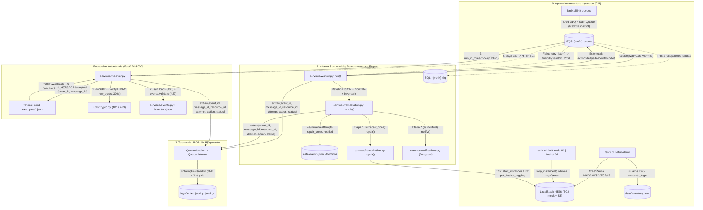

# Proyecto Fenix — Sistema de Autorreparacion de Infraestructura Cloud (TP Final 1)

**Materia:** Programacion para Automatizacion II (Opcion 4.3.1 del Programa)  
**Formador:** Prof. Jacobo Juarez  
**Repositorio:** [https://github.com/Mikoo/Fenix](https://github.com/Mikoo/Fenix)

---

## 1. Objetivo del Sistema

**Proyecto Fenix** es un sistema de autorreparacion de infraestructura (*Self-Healing Infrastructure*) orientado a eventos que recibe alertas operativas mediante un **webhook HTTP autenticado con HMAC-SHA256**, desacopla su procesamiento en una cola **AWS SQS** con **Dead Letter Queue (DLQ)** emulada en **LocalStack**, repara de forma **convergente e idempotente** recursos Cloud (**instancias EC2 mock** detenidas y **buckets S3** con perdida de etiquetas obligatorias) utilizando **Boto3**, persiste el progreso por etapas en un registro atomico local (`data/events.json`) y notifica el resultado a un canal operativo en **Telegram**.

---

## 2. Integrantes y Asignacion de Roles

| Rol | Integrante | Modulos Asignados (`src/fenix/` y `tests/`) | Pruebas y Evidencia Defendidas |
| :--- | :--- | :--- | :--- |
| **Rol 1 (I1):** Entradas y Excepciones | **Isasmendi, Leonel** | `utils/errors.py`<br>`utils/validation.py`<br>`services/events.py` | Contratos `identifier`, `ttl_seconds`, `utc_text`, `events.validate` (`F06`, `F07`) |
| **Rol 2 (I2):** Mensajeria e Inventario Cloud | **Isella, Lucia Daniza** | `config/settings.py`<br>`services/sqs.py`<br>`services/demo.py` (`setup_demo`) | Colas SQS/DLQ (`ensure_queues`, `retry_later`) e inventario idempotente (`F01`, `F08`, `F10`) |
| **Rol 3 (I3):** Webhooks y Reparacion | **Ahumada, German Maximiliano Leonel** | `utils/crypto.py`<br>`services/receiver.py`<br>`services/remediation.py` (`repair`) | Verificacion HMAC (`verify`), receptor FastAPI (`POST /webhook`) y reparacion EC2/S3 (`F02`, `F03`, `F04`, `F05`, `F13`) |
| **Rol 4 (I4):** Observabilidad y Comunicacion | **Vaca, Georgina Zulma** | `utils/logging_json.py`<br>`services/notifications.py` (`notify`) | Telemetria JSON asincrona (`QueueHandler`/`QueueListener`), rotacion `.gz` y Bot Telegram (`F14`, `F16`) |
| **Rol 5 (I5):** Integracion y Worker | **Sosa, Tamara Gabriela** | `services/worker.py`<br>`services/remediation.py` (`handle`)<br>`cli.py` | Worker secuencial, registro por etapas (`data/events.json`), conflictos y corte intermedio (`F09`, `F11`, `F12`, `F15`) |
| **Rol 6 (I6):** Pruebas y Diagnostico | **Paz Villarreal, Sebastian** | `services/demo.py` (`inject_fault`)<br>`tests/test_scenarios.py`<br>`tests/test_fenix.py` | Inyeccion de fallas (`fault`), stub de `notify` y matriz integral con DLQ (`F01`–`F16`) |

**Integrantes del equipo:**
- Ahumada, German Maximiliano Leonel
- Isasmendi, Leonel
- Isella, Lucia Daniza
- Paz Villarreal, Sebastian
- Sosa, Tamara Gabriela
- Vaca, Georgina Zulma

---

## 3. Estructura del Proyecto

```text
Fenix/
├── examples/
│   ├── bucket-event.json         # Evento de ejemplo para perdida de tags en S3
│   └── node-event.json           # Evento de ejemplo para instancia EC2 detenida
├── src/
│   └── fenix/
│       ├── config/
│       │   └── settings.py       # Fabrica de clientes Boto3 restringida a localhost:4566 [Apoyo / I2]
│       ├── services/
│       │   ├── cloud_support.py  # Recetas Boto3 entregadas por la catedra (VPC, AMI, S3, SG, EC2)
│       │   ├── demo.py           # Aprovisionamiento idempotente (setup_demo) [I2] e inject_fault [I6]
│       │   ├── events.py         # Validacion de esquema cerrado y pertenencia al inventario [I1]
│       │   ├── notifications.py  # Adaptador HTTP hacia Telegram Bot API con timeouts [I4]
│       │   ├── receiver.py       # Servidor FastAPI POST /webhook con run_in_threadpool [I3]
│       │   ├── remediation.py    # Reparacion convergente (repair) [I3] y ledger por etapas (handle) [I5]
│       │   ├── sqs.py            # Colas estandar, RedrivePolicy DLQ, recepcion, ACK y backoff [I2]
│       │   └── worker.py         # Ciclo de consumo secuencial tolerante a fallos [I5]
│       ├── utils/
│       │   ├── crypto.py         # Firma y verificacion HMAC-SHA256 sobre raw bytes (±300 s) [I3]
│       │   ├── errors.py         # Jerarquia ProjectError, ValidationError, RetryableError, PermanentError [I1]
│       │   ├── logging_json.py   # JSONFormatter UTC, QueueHandler, QueueListener y rotacion Gzip [I4]
│       │   ├── state.py          # Persistencia JSON por reemplazo atomico (os.replace)
│       │   └── validation.py     # Validadores identifier, ttl_seconds y utc_text [I1]
│       └── cli.py                # Punto de entrada CLI (init-queues, setup-demo, fault, send, worker) [I5]
├── tests/
│   ├── test_base.py              # Pruebas operativas del codigo de apoyo entregado
│   ├── test_contracts.py         # Pruebas de contratos de validacion [I1]
│   ├── test_fenix.py             # Pruebas de HMAC, receptor HTTP y reparacion convergente [I3 / I6]
│   └── test_scenarios.py         # Pruebas de idempotencia, orden de ACK y redrive a DLQ [I6]
├── evidencias/                   # Copias anonimizadas de logs, gzip, estado Boto3, DLQ y aviso Telegram
├── .env.example                  # Plantilla publica de variables de entorno sin secretos
├── .gitignore                    # Exclusion de .env, .venv/, logs/, data/ y caches
├── compose.yaml                  # Definicion del servicio LocalStack (sqs, s3, ec2 mock)
├── pyproject.toml                # Configuracion de empaquetado setuptools y marcadores pytest
├── requirements.txt              # Dependencias directas del proyecto
├── requirements-lock.txt         # Versiones exactas congeladas del entorno (pip freeze)
└── README.md                     # Documentacion tecnica e instrucciones de ejecucion
```

---

## 4. Prerrequisitos y Versiones

- **Sistema Operativo:** Windows 10/11, Linux o macOS (Python se ejecuta en el host).
- **Python:** `3.14.10` (compatible con `>= 3.11`).
- **Docker Desktop:** En ejecucion para levantar **LocalStack** (`localstack/localstack:2026.10.0`) en `127.0.0.1:4566` con `EC2_VM_MANAGER=mock` y `SERVICES=sqs,s3,ec2`.
- **Dependencias fijadas:** Ver `requirements.txt` y `requirements-lock.txt`.

---

## 5. Instalacion desde Cero

Ejecutar cada comando por separado en la terminal desde la raiz del proyecto:

1. **Crear el entorno virtual:**
   ```powershell
   python -m venv .venv
   ```
2. **Activar el entorno virtual (Windows PowerShell):**
   ```powershell
   .\.venv\Scripts\Activate.ps1
   ```
   *(En Linux/macOS/WSL: `source .venv/bin/activate`)*
3. **Instalar el paquete `ppa2-fenix` en modo editable:**
   ```powershell
   python -m pip install -e .
   ```
4. **Crear el archivo `.env` local a partir de la plantilla `.env.example`:**
   ```powershell
   Copy-Item .env.example .env
   ```
5. **Generar una clave simetrica segura para `WEBHOOK_SECRET` (>= 16 caracteres):**
   ```powershell
   python -c "import secrets; print(secrets.token_urlsafe(32))"
   ```
   Asignar el valor generado en la variable `WEBHOOK_SECRET=` dentro del archivo `.env`.
6. **Levantar LocalStack en Docker:**
   ```powershell
   docker compose up -d
   ```
7. **Ejecutar las pruebas base y de contratos implementados:**
   ```powershell
   python -m pytest -m base -q
   ```
   ```powershell
   python -m pytest tests/test_fenix.py -v
   ```

---

## 6. Variables de Entorno (`.env.example` — Sin Valores Privados)

El archivo `.env` nunca se incluye en el control de versiones. Las variables requeridas son:

| Variable | Valor de Referencia | Proposito |
| :--- | :--- | :--- |
| `AWS_ENDPOINT_URL` | `http://localhost:4566` | Endpoint exclusivo de LocalStack (validado contra destinos fuera de loopback). |
| `AWS_ACCESS_KEY_ID` | `test` | Credencial ficticia exigida por Boto3 para el emulador. |
| `AWS_SECRET_ACCESS_KEY` | `test` | Credencial ficticia exigida por Boto3 para el emulador. |
| `AWS_DEFAULT_REGION` | `us-east-1` | Region estandar del laboratorio para SQS, S3 y EC2 mock. |
| `GROUP_ID` | `grupo01` | Identificador del equipo usado en nombres y tags de propiedad (`GroupId`, `Owner`). |
| `QUEUE_PREFIX` | `fenix-grupo01` | Prefijo para las colas `{prefix}-events` y `{prefix}-dlq`. |
| `PROJECT` | `fenix` | Etiqueta de proyecto (`Project=fenix`). |
| `WEBHOOK_SECRET` | `<secreto_simetrico_>=16_chars>` | Clave compartida para firmar y verificar `X-Webhook-Signature` con HMAC-SHA256. |
| `NOTIFY_PROVIDER` | `console` o `telegram` | Canal de notificacion (`console` en desarrollo; `telegram` para evidencia real). |
| `TELEGRAM_BOT_TOKEN` | `<configurar_en_env>` | Token del Bot creado en `@BotFather` (nunca se registra en logs ni excepciones). |
| `TELEGRAM_CHAT_ID` | `<configurar_en_env>` | ID del chat o grupo de pruebas autorizado del equipo. |
| `LOCALSTACK_IMAGE` | `localstack/localstack:2026.10.0` | Imagen fija de LocalStack para `compose.yaml`. |

---

## 7. Diagrama de Arquitectura



---

## 8. Contratos de Entrada y Salida

### 8.1. Evento de Entrada (`POST /webhook`)
Esquema JSON cerrado (los 6 campos son obligatorios, no se admiten claves adicionales ni `bool` como `int`):
```json
{
  "schema_version": 1,
  "event_id": "evt-node-001",
  "event_type": "instance.stopped",
  "resource_id": "node-01",
  "occurred_at": "2026-10-22T18:00:00Z",
  "simulate_failures": 0
}
```
- **Cabecera de autenticacion:** `X-Webhook-Signature: t=<epoch_segundos>,v1=<hmac_sha256_64_hex>` calculada sobre `ascii(timestamp) + b"." + raw_body` con ventana de tolerancia de `±300` segundos.

### 8.2. Codigos de Respuesta del Receptor (`POST /webhook`)
- **`202 Accepted`:** `{"status": "accepted", "event_id": "evt-node-001", "message_id": "..."}` (solo despues de confirmar `send_message` en SQS).
- **`400 Bad Request`:** Cuerpo con UTF-8 invalido o JSON malformado tras verificar una firma valida.
- **`401 Unauthorized`:** Firma ausente, malformada, clave duplicada, fuera de ventana (±300 s) o hash invalido.
- **`413 Payload Too Large`:** Cuerpo superior a `16384` bytes (16 KiB).
- **`422 Unprocessable Entity`:** JSON valido que no es un objeto (`dict`) o incumple el contrato/inventario.
- **`503 Service Unavailable`:** Broker SQS o inventario local inaccesibles.

---

## 9. Ejecucion por Terminal

1. **Inicializar colas SQS (`{prefix}-dlq` y `{prefix}-events`) e inventario Cloud (`node-01` y `bucket-01`):**
   ```powershell
   python -m fenix.cli init-queues
   ```
   ```powershell
   python -m fenix.cli setup-demo
   ```
2. **Inyectar una falla controlada en el laboratorio:**
   ```powershell
   python -m fenix.cli fault node-01
   ```
3. **Terminal 1 — Iniciar el servidor receptor FastAPI (1 worker):**
   ```powershell
   python -m uvicorn fenix.services.receiver:app --host 127.0.0.1 --port 8000 --workers 1 --env-file .env
   ```
4. **Terminal 2 — Iniciar el worker consumidor:**
   ```powershell
   python -m fenix.cli worker
   ```
5. **Terminal 3 — Enviar la alerta firmada:**
   ```powershell
   python -m fenix.cli send examples/node-event.json
   ```

---

## 10. Reglas de Reintento, Backoff y DLQ

- **Visibilidad inicial:** `VisibilityTimeout = 45` segundos por recepcion, con Long Polling de `WaitTimeSeconds = 10`.
- **Backoff en SQS (`retry_later`):** Ante un fallo recuperable o de validacion dentro del worker, nunca se re-envia una copia del mensaje (`send_message` reiniciaria el contador de recepciones). En su lugar, se invoca `change_message_visibility` sobre el `ReceiptHandle` actual con `min(30, 2 ** ApproximateReceiveCount)` (demoras de **2 s**, **4 s** y **8 s**).
- **Derivacion automatica a DLQ:** La cola principal configura `RedrivePolicy` con `maxReceiveCount = "3"` hacia `{prefix}-dlq`. Si el mensaje falla en 3 entregas, SQS lo aisla automaticamente en la DLQ.

---

## 11. Decisiones de Idempotencia y Convergencia

1. **Reemplazo atomico en disco (`state.py`):** Tanto `data/inventory.json` como `data/events.json` se escriben en un archivo `.tmp` dentro del mismo directorio y se publican con `os.replace()`.
2. **Persistencia por etapas (`remediation.handle`):**
   - `attempts` se incrementa y guarda en disco antes de evaluar `simulate_failures` o llamar a AWS.
   - Una vez que `repair()` devuelve `"repaired"` o `"already_ok"`, se persiste `repair_done = True` antes de invocar `notify()`. Si la notificacion a Telegram falla por timeout o `429`, la siguiente entrega de SQS lee `repair_done == True` y ejecuta unicamente el aviso pendiente sin volver a modificar EC2 ni S3.
3. **Reparacion convergente (`remediation.repair`):**
   - **EC2 (`node-01`):** Se consulta `describe_instances` antes y despues. Si ya esta `"running"`, retorna `"already_ok"`. Si esta `"stopped"`, utiliza `start_instances` (convergente al estado deseado) y nunca `reboot_instances`.
   - **S3 (`bucket-01`):** Se consultan las etiquetas con `get_bucket_tagging` (tratando solo `NoSuchTagSet` como vacio) y se combinan con `{**current, **expected}` para preservar etiquetas ajenas y restaurar las obligatorias.

---

## 12. Matriz de Pruebas (`F01` a `F16`)

| ID | Caso y Preparacion | Comando / Test `pytest` | Resultado Esperado | Resultado Observado | Evidencia | Responsable |
| :--- | :--- | :--- | :--- | :--- | :--- | :--- |
| **F01** | `init-queues` y `setup-demo` dos veces | `python -m fenix.cli init-queues` / `setup-demo` | Mismas colas y recursos; sin duplicados | Pendiente integracion | `evidencias/01_inventory_generado.json` | I2 |
| **F02** | Nodo detenido, evento firmado valido | `pytest tests/test_fenix.py -k f02` + LocalStack | `running` verificado, ledger completo, aviso y ACK | PASSED (Unitario) / Pendiente integracion | `evidencias/06_verificacion_boto3_ec2_s3.json` | I3 |
| **F03** | Bucket sin `Owner` y con tag ajena | `pytest tests/test_fenix.py -k f03` + LocalStack | Tags restauradas y etiquetas ajenas preservadas | PASSED (Unitario) / Pendiente integracion | `evidencias/06_verificacion_boto3_ec2_s3.json` | I3 |
| **F04** | Firma ausente/alterada y timestamp de hace 1 h | `pytest tests/test_fenix.py -k f04` | HTTP `401` y `0` mensajes en SQS | PASSED (`401`, `0` publicados) | `tests/test_fenix.py` | I3 |
| **F05** | Mismos datos JSON con bytes distintos tras firmar | `pytest tests/test_fenix.py -k f05` | HTTP `401` por HMAC invalida | PASSED (`401` verificado) | `tests/test_fenix.py` | I3 |
| **F06** | JSON roto firmado; luego lista JSON `[]` firmada | `pytest tests/test_fenix.py -k f06` | HTTP `400` y `422` respectivamente; sin publicar | PASSED (`400` y `422`) | `tests/test_fenix.py` | I1 / I3 |
| **F07** | Alias ajeno y claves extra en el evento | `pytest tests/test_contracts.py` | `ValidationError` / `422`; ningun cambio cloud | Pendiente I1 | `tests/test_contracts.py` | I1 |
| **F08** | Evento directo a SQS con JSON corrupto | `pytest -m integracion` | Worker sigue vivo; mensaje termina en DLQ | Pendiente I2/I6 | `evidencias/07_mensaje_leido_de_dlq.json` | I2 / I6 |
| **F09** | `simulate_failures=2` con ID nuevo | `pytest tests/test_scenarios.py` | Backoff 2 s y 4 s; intento 3 repara y hace ACK | Pendiente I5 | `evidencias/04_log_fallo_y_backoff.jsonl` | I5 |
| **F10** | Falla persistente (`simulate_failures=5`) | `pytest -m integracion` | Sin ACK; derivacion automatica a DLQ | Pendiente I2/I6 | `evidencias/07_mensaje_leido_de_dlq.json` | I2 / I6 |
| **F11** | Repetir evento ya completo; reiniciar worker | `pytest tests/test_scenarios.py` | Sin nueva reparacion ni aviso repetido | Pendiente I5/I6 | `evidencias/02_events_ledger_completo.json` | I5 |
| **F12** | Corte tras `repair_done` y antes de `notify` | `pytest tests/test_scenarios.py` | Reinicio recupera solo aviso pendiente | Pendiente I5 | `evidencias/02_events_ledger_completo.json` | I5 |
| **F13** | SQS detenido al recibir webhook | `pytest tests/test_fenix.py -k f13` | HTTP `503`; no hay aceptacion falsa | PASSED (`503` verificado) | `tests/test_fenix.py` | I3 |
| **F14** | Mock de aviso `429`/timeout y luego exito | `pytest tests/test_scenarios.py` | Reparacion no se repite; aviso reintentado | Pendiente I4/I6 | `evidencias/03_log_nominal.jsonl` | I4 / I6 |
| **F15** | Cambiar payload conservando `event_id` | `pytest tests/test_scenarios.py` | Conflicto (`PermanentError`); no altera ledger original | Pendiente I5 | `evidencias/04_log_fallo_y_backoff.jsonl` | I5 |
| **F16** | Forzar rotacion, abrir `.gz` y parsear lineas | `pytest tests/test_base.py` / `test_scenarios.py` | JSON valido, UTC `+00:00` y cero secretos | Pendiente I4 | `evidencias/05_historico_rotado.jsonl.gz` | I4 |

---

## 13. Limitaciones Conocidas del Diseno

- **Estado local para un unico proceso escritor:** `data/events.json` utiliza reemplazo atomico (`os.replace`), adecuado para una instancia de worker local, pero no provee bloqueo distribuido entre multiples hosts ni transacciones conjuntas con AWS y Telegram.
- **Ventana de incertidumbre al notificar:** Si el proceso cae exactamente despues de que Telegram acepto el HTTP POST pero antes de persistir `notified = True` en `data/events.json`, el reintento enviara el aviso por segunda vez (entrega *at-least-once*), pero nunca repetira la reparacion sobre EC2 o S3.

---

## 14. Evidencia del Canal Elegido (Telegram) y Limpieza del Laboratorio

- **Proveedor adoptado:** **Telegram Bot API** (`POST https://api.telegram.org/bot<TOKEN>/sendMessage`), validando tanto codigo HTTP `200` como `ok: true` en el cuerpo JSON, con `timeout=(2, 5)`.
- **Proteccion de credenciales:** Toda excepcion de `requests` se captura y se traduce a `RetryableError` o `PermanentError` con mensajes genericos, impidiendo que la URL con el token del bot llegue a los archivos de `logs/` o a la consola.
- **Limpieza del laboratorio:** Al concluir las pruebas y despues de documentar la lectura de la DLQ en `evidencias/`, detener el receptor y el worker (`Ctrl+C`) y dar de baja el entorno emulado:
  ```powershell
  docker compose down
  ```

### Declaracion de Uso de Herramientas y Asistencia de IA
De acuerdo con el reglamento del Trabajo Final (Seccion 2.2), se declara el uso de asistencia de IA como guia de estudio y revision de estilo PEP 8 / tipado sobre la plantilla base entregada por la catedra (`fenix_template.zip`). Cada integrante escribio, verifico manualmente en su entorno local con `pytest`, `flake8` y `pylint`, y audito las decisiones de diseno de su modulo asignado.
